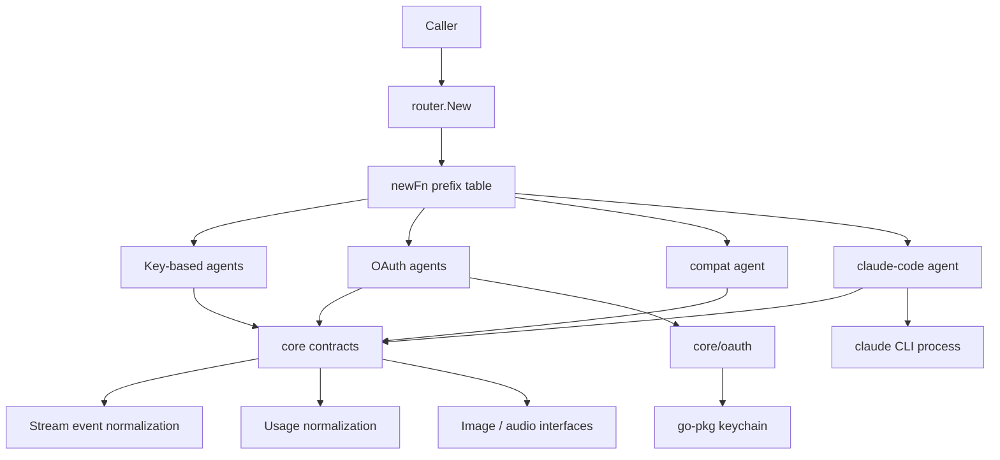

# Architecture

`go-llm-router` has three layers: the contract layer (`core`), the assembly layer (`core/router`), and the provider adapters. This page shows only the layer relationships; per-module diagrams, sequence diagrams, and state machines live in the [full architecture document](https://github.com/pardnchiu/go-llm-router/blob/master/doc/architecture.md).

## Overview

## Layers

| Layer | Packages | Responsibility | Dependency direction |
|---|---|---|---|
| Contract | `core` | Agent interfaces, message and usage types, reasoning levels, modes, model classification, SSE normalization, optional multimodal interfaces | depends on no provider |
| Assembly | `core/router` | Builds an Agent from `provider@model`; rewrites unknown prefixes to compat | depends on `core` and every provider |
| Adapters | `core/claude`, `core/claudeCode`, `core/openai`, `core/gemini`, `core/grok`, `core/deepseek`, `core/mistral`, `core/nvidia`, `core/ollamaCloud`, `core/openRouter`, `core/cloudflare`, `core/compat`, `core/copilot`, `core/openaiCodex`, `core/grokOauth` | Message conversion, wire-format differences, model listings, optional capabilities | depend on `core` and the shared wire helpers |
| Shared wire helpers | `core/copilot/response`, `core/xai` | Responses API input/tool/output conversion; xAI Responses request body and SSE assembly | depend on `core`; `core/xai` also uses `core/copilot/response` |
| Credentials | `core/oauth/copilot`, `core/oauth/codex`, `core/oauth/grok` | Login flows, token storage and refresh | depend on `core` and the go-pkg keychain |
| Utility | `core/gemini/summary` | `VoiceReply`: rewrites text over 320 characters into a spoken summary via Gemini, key read from the keychain `GEMINI_API_KEY` | depends on go-pkg only |

Among other tools that call many LLM APIs, LiteLLM, Bifrost, and GoModel are positioned as AI gateways deployed as a separate service, while `go-llm-router` is a library imported into your Go program with no proxy in between. OpenRouter is a hosted unified interface; here each provider is called directly with its own API key or OAuth token, and `openrouter` is itself one of the 15 provider prefixes. LangChainGo, Eino, and Genkit are application frameworks for chains, agents, and RAG; this project covers only the provider call layer and is used on its own. go-openai and openai-go focus on the OpenAI API, whereas one `Agent` interface here switches across 15 provider prefixes. Alongside gollm, GoAI, Jetify AI, and the Python library any-llm, which also wrap multiple providers, `go-llm-router` brings `provider@model` string routing, a driver for the local Claude Code CLI, Copilot / Codex / Grok OAuth with keychain storage, quota and balance queries, and usage normalization that keeps cache tokens.

## Adapter groups

| Group | Packages | Wire format |
|---|---|---|
| OpenAI-compatible | `openai`, `deepseek`, `mistral`, `nvidia`, `openRouter`, `ollamaCloud`, `compat` | Chat Completions; newer OpenAI generations switch to Responses |
| Cloudflare | `cloudflare` | Workers AI `/ai/run` with a `{model, input}` body sent through an AI Gateway (`cf-aig-gateway-id`); no streaming |
| Anthropic | `claude` | Messages API; `budget_tokens` thinking on 4.5 / 4.1 models, adaptive thinking plus `output_config.effort` on newer ones |
| Google | `gemini` | `:generateContent` with raw JSON Schema tools (`parametersJsonSchema`) and `cachedContents` prefix caching |
| xAI | `grok`, `grokOauth` | Responses API built by `core/xai`, plus the image endpoints |
| OAuth proxies | `copilot`, `openaiCodex` | Vendor-internal endpoints requiring a session token: `copilot` picks Chat Completions or Responses from the model's `supported_endpoints`, `openaiCodex` always uses the ChatGPT backend Responses endpoint |
| Local CLI | `claudeCode` | `claude -p` stream-JSON over stdin/stdout, one process per session, text-protocol tool calls |

## Cross-cutting principles

| Principle | What it means |
|---|---|
| One-way dependencies | Adapters depend on `core` and the shared wire helpers (`core/copilot/response` for `openai`, `codex`, `copilot`; `core/xai` for both Grok adapters). Two adapter-to-adapter exceptions: `grokOauth` reuses `grok.RequestImage`, `openaiCodex` reuses the `openai` image helpers |
| Capabilities are interfaces | Streaming, reasoning limits, image, STT, and TTS are optional interfaces rather than flags or config fields |
| Errors carry status | `Send` returns the upstream HTTP status; stream failures wrap into `*llmrouter.StreamError` keeping `Provider` / `Code` / `Body` |
| Read caps live in the contract layer | 64 MiB non-streamed audio body, 8 KiB error body, 512-byte error frame, 64 KiB JSON body, all defined once in `core` |
| Shared HTTP client | `llmrouter.NewHTTPClient` gives a 10-minute timeout; `codex` and `grok-oauth` build their own client with a 15-second response-header timeout |

## Further reading

- [Full architecture document](https://github.com/pardnchiu/go-llm-router/blob/master/doc/architecture.md): per-module diagrams, the request sequence, OAuth and stream state machines
- [Agent Contract](/core-concepts): the Agent interface and optional capabilities
- [Model Routing](/core-concepts-routing): how `provider@model` resolves
- [Interfaces and Router](/api-reference): exported interfaces and provider packages
