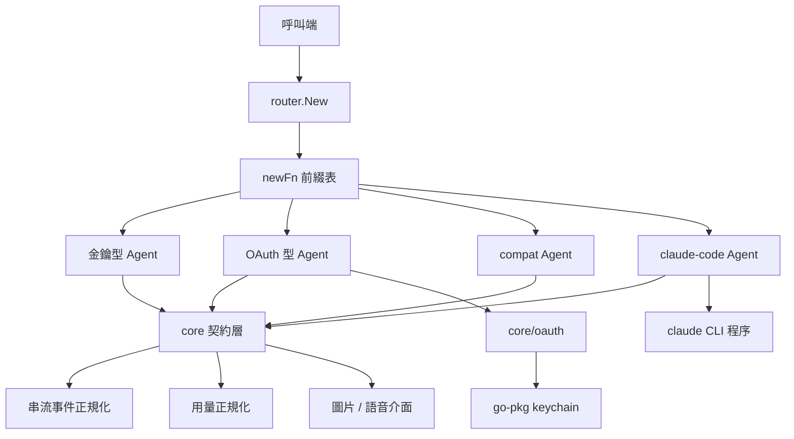

# 架構

`go-llm-router` 分成三層：契約層（`core`）、組裝層（`core/router`）、供應商轉接層（各 provider 套件）。本頁只放整體層級關係，模組級展開、序列圖與狀態機在 [完整架構文件](https://github.com/pardnchiu/go-llm-router/blob/master/doc/architecture.zh.md)。

## 概覽

## 分層

| 層 | 套件 | 職責 | 相依方向 |
|---|---|---|---|
| 契約層 | `core` | Agent 介面、訊息與用量型別、推理等級、模式、模型分類、SSE 正規化、多模態選用介面 | 不相依任何 provider |
| 組裝層 | `core/router` | 由 `provider@model` 查表建構 Agent；未知前綴改寫為 compat | 相依 `core` 與全部 provider |
| 轉接層 | `core/claude`、`core/claudeCode`、`core/openai`、`core/gemini`、`core/grok`、`core/deepseek`、`core/mistral`、`core/nvidia`、`core/ollamaCloud`、`core/openRouter`、`core/cloudflare`、`core/compat`、`core/copilot`、`core/openaiCodex`、`core/grokOauth` | 訊息轉換、線路格式差異、模型清單、選用能力 | 相依 `core` 與共用傳輸輔助 |
| 共用傳輸輔助 | `core/copilot/response`、`core/xai` | Responses API 輸入／工具／輸出轉換；xAI Responses 請求 body 與 SSE 組裝 | 相依 `core`；`core/xai` 另用 `core/copilot/response` |
| 憑證層 | `core/oauth/copilot`、`core/oauth/codex`、`core/oauth/grok` | 登入流程、權杖保存與換新 | 相依 `core` 與 go-pkg keychain |
| 工具層 | `core/gemini/summary` | `VoiceReply`：超過 320 字元的文字以 Gemini 改寫成可朗讀摘要，金鑰取自 keychain 的 `GEMINI_API_KEY` | 只相依 go-pkg |

在同樣串接多家 LLM API 的工具中，LiteLLM、Bifrost、GoModel 定位為需另外部署的 AI gateway；`go-llm-router` 則是直接 import 進 Go 程式的函式庫，中間沒有 proxy。OpenRouter 是託管的統一介面服務；本專案以各家自己的 API key 或 OAuth token 直連供應商，`openrouter` 本身也是 15 個 provider prefix 之一。LangChainGo、Eino、Genkit 是處理 chains、agents、RAG 的應用框架；本專案只負責供應商呼叫層，可單獨使用。go-openai 與 openai-go 專注 OpenAI API；本專案以同一個 `Agent` 介面切換 15 個 provider prefix。與同樣包裝多家供應商的 gollm、GoAI、Jetify AI 及 Python 函式庫 any-llm 相比，`go-llm-router` 提供 `provider@model` 字串路由、驅動本機 Claude Code CLI、Copilot／Codex／Grok OAuth 與 keychain 儲存、額度與餘額查詢，以及保留 cache token 的 usage 正規化。

## 轉接層分群

| 群組 | 套件 | 線路格式 |
|---|---|---|
| OpenAI 相容 | `openai`、`deepseek`、`mistral`、`nvidia`、`openRouter`、`ollamaCloud`、`compat` | Chat Completions；OpenAI 新世代模型改走 Responses |
| Cloudflare | `cloudflare` | Workers AI `/ai/run`，以 `{model, input}` body 經 AI Gateway（`cf-aig-gateway-id`）送出；不支援串流 |
| Anthropic | `claude` | Messages API；4.5／4.1 模型用 `budget_tokens` thinking，較新模型用 adaptive thinking 加 `output_config.effort` |
| Google | `gemini` | `:generateContent`，工具以 `parametersJsonSchema` 傳送原始 JSON Schema，並使用 `cachedContents` 前綴快取 |
| xAI | `grok`、`grokOauth` | 由 `core/xai` 組出的 Responses API + 圖片端點 |
| OAuth 代理 | `copilot`、`openaiCodex` | 廠商內部端點，需 session 權杖：`copilot` 依模型的 `supported_endpoints` 選 Chat Completions 或 Responses，`openaiCodex` 一律走 ChatGPT 後端的 Responses 端點 |
| 本機 CLI | `claudeCode` | 以 stdin/stdout 與 `claude -p` 交換 stream-JSON，每個 session 一個程序，工具呼叫走文字協定 |

## 跨切原則

| 原則 | 內容 |
|---|---|
| 單向相依 | 轉接層相依 `core` 與共用傳輸輔助（`openai`、`codex`、`copilot` 用 `core/copilot/response`；兩個 Grok 轉接層用 `core/xai`）。轉接層之間的例外僅兩處：`grokOauth` 共用 `grok.RequestImage`、`openaiCodex` 共用 `openai` 的圖片 helper |
| 能力以介面表達 | 串流、推理上下限、圖片、STT、TTS 皆為選用介面，不用旗標或設定欄位表示 |
| 錯誤帶狀態碼 | `Send` 回傳上游 HTTP 狀態；串流錯誤包成 `*llmrouter.StreamError` 保留 `Provider` / `Code` / `Body` |
| 讀取上限固定在契約層 | 非串流音訊 body 64 MiB、錯誤 body 8 KiB、錯誤 frame 512 bytes、JSON body 64 KiB，由 `core` 統一定義 |
| HTTP client 共用 | `llmrouter.NewHTTPClient` 提供 10 分鐘 timeout；`codex` 與 `grok-oauth` 另建帶 15 秒 response header timeout 的 client |

## 延伸閱讀

- [完整架構文件](https://github.com/pardnchiu/go-llm-router/blob/master/doc/architecture.zh.md)：模組詳細圖、資料流序列圖、OAuth 與串流狀態機
- [Agent 契約](/zh/core-concepts)：Agent 介面與選用能力
- [模型路由](/zh/core-concepts-routing)：`provider@model` 如何解析
- [介面與工廠](/zh/api-reference)：匯出介面與供應商套件
